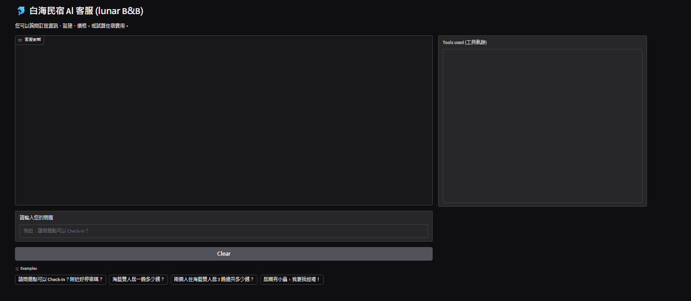
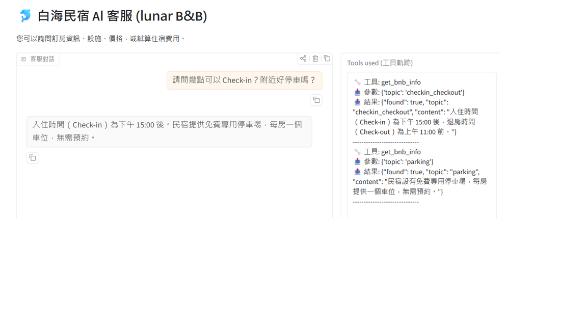

<!--
  FOR YOUR REFERENCE (FYR): a template for the README.md of your own GitHub repository.

  HOW TO USE THIS TEMPLATE
  1. Copy this file into your project folder and rename it to README.md.
  2. Replace every part in [square brackets] with your own words. Delete the example text you do not need.
  3. Delete these comment blocks (the grey notes like this one). GitHub does not show comments,
     but a clean file is easier to read.
  4. Put your screenshots in a folder named images/ in your project, and check that they show on GitHub.
-->

# Lunar B&B Assistant: Answers Questions About Rooms, Prices and Check-In

This AI customer service assistant is designed for White Dolphin B&B. It serves potential and existing guests who want to book a room, check availability, or ask about rules. It solves the problem of delayed manual replies by providing instant, 24/7 answers and accurate price calculations.

> Course homework: Unit G, My AI Customer Service Agent, with a Database and Tools
> Student: F1152345 Yuki Wu



## Who It Serves and When They Use It

- **Who uses it:** Guests who want to book a room or ask about check-in and parking.
- **When they use it:** At night, or during busy hours when staff cannot answer the phone immediately.
- **What problem it solves:** The same repetitive questions about room prices, check-in times, and parking come in every day.

## What It Can Do

| Function | Example question | Tool it uses |
|---|---|---|
| [Tell the check-in time and the address] | "What time can I check in?" | [`get_bnb_info`] |
| [Find a free room] | "Do you have a double room?" | [`search_rooms`] |
| [Work out the price of a stay] | "How much are three nights in an ocean view room?" | [`calculate_stay`] |
| [Hand over to a person] | "I want to make a complaint." | [`transfer_to_human`] |

## How It Works

Every question goes to the agent first. The agent chooses a tool, the tool reads the database
or calculates in code, and the agent answers only from what the tool returns.

- **Model:** Furen-large
- **Chat screen:** Gradio
- **Database (SQLite):** built from the CSV files every time the program starts.

  | Table | CSV file | What it holds | Rows |
  |---|---|---|---|
  | [`bnb_info`] | [`bnb_info.csv`] | [topics such as check-in time, address, parking] | [10] |
  | [`rooms`] | [`rooms.csv`] | [room types, prices, availability, description] | [6] |

- **Tools:**

  | Tool | What it does |
  |---|---|
  | [`get_bnb_info(topic)`] | [reads one topic from `bnb_info`] |
  | [`search_rooms(keyword)`] | [finds rooms in `rooms` using forgiving keyword matching] |
  | [`calculate_stay(room_name, nights)`] | [nights × price, calculated in code] |
  | [`transfer_to_human()`] | [gives the staff phone number and LINE ID] |

## Sample Conversations




## Project Files

```text
Week7/
├── app.py              # the agent: database, tools, agent loop and chat screen
├── test_agent.py       # automated tool-choice test script
├── bnb_info.csv        # the information table
├── rooms.csv           # the records table
├── requirements.txt    # the Python packages to install
├── .env.example        # a sample settings file (no real key)
├── .gitignore          # files git must not upload: .env and *.db
├── images/             # screenshots for this README
└── README.md           # this file

## How to Install and Run It

1. Download the project:

   ```bash
   git clone https://github.com/f115118123-nkust/AI-Customer-Service-Agent.git
   cd AI-Customer-Service-Agent
   ```

2. Install the packages (Python 3.10 or newer):

   ```bash
   pip install -r requirements.txt
   ```

3. Make your settings file. Copy `.env.example` to `.env`, then put your own API key after `API_KEY=`.
   The model must support tool calling.

   ```bash
   copy .env.example .env      # Windows
   cp .env.example .env        # macOS or Linux
   ```

4. Start the agent. It builds the database from the CSV files, then opens the chat page:

   ```bash
   python app.py
   ```

5. Open the link shown in the console, usually <http://127.0.0.1:7860>.

<!-- If you used another framework or a mobile app, write your own steps here,
     for example: npm install, npm run dev, or flutter run. -->

## Notes

- All names, phone numbers, prices and bookings in the data are **made up**. [If you used public information
  from a real shop or office, say where it came from.]
- The `.env` file holds the API key. It is **not** in this repository. Make your own from `.env.example`.
- [Anything else the reader should know, for example the limits of the agent or ideas for the next version.]
